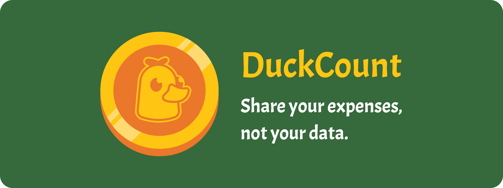

<p align="center">
  
</p>

DuckCount keeps track of shared expenses between friends, flatmates, travel companions or family. Everyone records what they paid, and DuckCount works out what each person owes and the settlements that even things out. Everything you write is encrypted on your phone before it leaves it: the people involved can read it, and the server, us included, cannot.

DuckCount is made in France by [Lidory](https://lidory.com). The Android app is in English and French and runs on Android 8.0 or later. The iOS app is in development and not released yet.

## Features

- **Groups** for a trip, a shared flat or a night out, with up to 100 members.
- **Expenses** in seconds: who paid, how much, in which currency and for whom, split evenly or with a share of their own for some.
- **Expenses without a group**, shared with one or more contacts.
- **Balances** for everybody, and the **settlements** that clear them.
- **History** of every expense and every group.
- **Contacts** added by username.
- **Notifications** through Google's services, or through any [UnifiedPush](https://unifiedpush.org) distributor installed on the phone, so they reach a phone without Google services too.
- **No email address and no phone number**: a username and a password are all an account needs.
- **No ads, no trackers, no analytics.** DuckCount handles no payment: settlements happen outside the app.

## Privacy and security

- **Sign-in** uses [OPAQUE](https://datatracker.ietf.org/doc/rfc9807/), so the password never reaches the server. Nobody can reset it: an account whose password is lost is lost.
- **Groups** run on [MLS](https://datatracker.ietf.org/doc/rfc9420/), with the post-quantum ML-KEM-768 + X25519 hybrid suite. A group's expenses are sealed under keys only its members hold, and every version is signed by its author.
- **Profiles**, names included, are encrypted for your contacts and the members of your groups only.
- **Your contact list and your keys** are kept on the server in a vault the server cannot open, using zero-access encryption.
- **Usernames** reach the server only as SHA3-512 digests.
- **Sizes are padded**: amounts, titles, descriptions, profiles and the contact list are sealed at a few set sizes, so their length gives little away.
- **On the phone**, the database is encrypted with SQLCipher under a key held by the Android Keystore.
- **Push messages** say only what kind of event happened and who caused it. The phone fetches the rest itself, and drops a push from a stranger, contact requests aside.
- **Accounts are created on real phones only**: registration asks for an Android key attestation from a phone with a locked bootloader, running its official system or GrapheneOS. This keeps out mass-created accounts. Signing in is not restricted.
- **Deleting your account** from the app erases it from the server, and so do two years without any use.

The cryptography lives in [Lib-DuckCount](https://github.com/lidory-dev/Lib-DuckCount), written in Rust, as do the debt and settlement calculations. No third-party audit has been carried out yet.

### What the server cannot see

Everything you write is encrypted on your phone before it is sent. The server cannot read:

- your password;
- your usernames, which it knows only by their digests;
- the title, description, amount, and currency of your expenses, and how each one is split;
- who paid and who shares in a group's expense;
- the name, description and currency of your groups;
- your profile, your name included;
- your contact list and the users you blocked;
- balances and settlements, which only the phones work out.

### What the server still sees

Encryption hides what you write, not everything about how you use the app. The server knows:

- each account's random identifier and the digests of its usernames;
- who belongs to which group, and who sends an encrypted message to whom;
- who paid and who shares in an expense outside a group;
- when expenses are written, edited or deleted, and how many there are;
- which of the set sizes a description or a contact list falls in;
- the IP addresses it is reached from, and the push address of each device.

## Building

### Requirements

- JDK 21: the build fails on JDK 25.
- The Android SDK, found through `ANDROID_HOME` or `sdk.dir` in `local.properties`, with NDK `29.0.14206865` and platform 37. Install the platform beforehand: the Android Gradle plugin fails the build in which it downloads it.
- [rustup](https://rustup.rs). The Rust version and its Android and iOS targets are those of `lib-duckcount/rust-toolchain.toml`.
- CMake and a C compiler, for the cryptography library's post-quantum code.
- Xcode, for iOS only.

### Getting the code

The Rust library is a git submodule, fetched from the same place as this repository:

```bash
git clone https://github.com/lidory-dev/DuckCount-App.git
cd DuckCount-App
git submodule update --init --recursive
(cd lib-duckcount && rustup toolchain install)
```

The last line installs the Rust version the library is built with, and its targets.

### Android

```bash
./gradlew :composeApp:assembleDebug
./gradlew :composeApp:installDebug
./gradlew test
```

A debug build talks to an API on the device's own loopback, port 60000, which `adb reverse tcp:60000 tcp:60000` forwards to a server running on your computer. The server is not part of this repository. A release build talks to `https://api.duckcount.app`. A build you sign yourself can sign in to an existing account, but cannot create one: registration accepts only the official signature.

Release builds are reproducible on Linux x86_64. That is how F-Droid checks that the APK we publish is built from this source: [fdroid/README.md](fdroid/README.md) has the steps.

### iOS

Open `iosApp/iosApp.xcodeproj` in Xcode and run it. Xcode builds the Kotlin framework through Gradle on its own. To sign with your own team, change `TEAM_ID` in `iosApp/Configuration/Config.xcconfig` rather than in Xcode's signing settings.

## Project layout

| Module | Role |
|---|---|
| `composeApp` | The Android app: entry point, navigation, dependency injection, push. |
| `shared` | Kotlin Multiplatform data layer for Android and iOS: encrypted database, networking, sync, encryption of everything sent. |
| `lib-duckcount` | The [Lib-DuckCount](https://github.com/lidory-dev/Lib-DuckCount) submodule: cryptography and expense calculations in Rust, used from Kotlin and Swift through UniFFI. |
| `feature/*` | The Android screens, one module per part of the app: authentication, expenses, groups, contacts, settings. |
| `android-ui` | The Android design system: theme, colours, fonts, shared components. |
| `iosApp` | The iOS app, in SwiftUI. |

## Reporting a problem

- Security vulnerabilities: [security@duckcount.com](mailto:security@duckcount.com).
- Abuse by another user: [report@duckcount.com](mailto:report@duckcount.com).

## Legal

- [Privacy policy](https://lidory.com/duckcount/confidentialite)
- [Terms of use](https://lidory.com/duckcount/conditions-utilisation)
- [Deleting your account](https://lidory.com/duckcount/suppression-compte)

These pages are in French.

## Licence

DuckCount is free software, licensed under the [European Union Public Licence 1.2](LICENSE), as is Lib-DuckCount.

The app's fonts are licensed under the [SIL Open Font License 1.1](https://openfontlicense.org):

- [ABeeZee](https://github.com/googlefonts/abeezee), by Anja Meiners, for body text.
- DuckCount Display, for titles. It is [Acme](https://fonts.google.com/specimen/Acme) by Juan Pablo del Peral, with its circumflex accents turned the right way up. The OFL reserves the name Acme, so the modified font has a name of its own.
